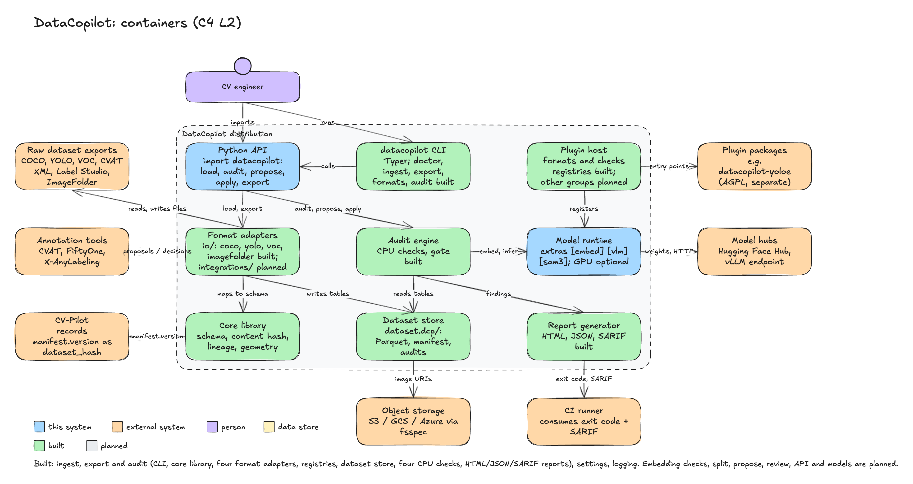

# 01 Overview

## Purpose

DataCopilot turns a dataset export into a versioned, queryable directory (`dataset.dcp/`),
audits it with reproducible checks, converts it to other formats without silent loss, and
produces model-generated fix proposals that a person reviews before they are applied.
It is a CLI and a Python library. It runs in one process, on CPU, without a server.

## Users

| Persona | What they do with DataCopilot |
|---|---|
| CV engineer preparing training data | Ingests a CVAT or COCO export, runs `audit`, fixes leakage and box errors, re-splits by session, exports YOLO for training. Records `manifest.version` with the run (via CV-Pilot). |
| Label reviewer (annotator, QA) | Receives proposals as a separate layer in CVAT, FiftyOne or X-AnyLabeling; accepts or rejects; never touches DataCopilot directly. |
| CI maintainer | Adds `datacopilot audit --fail-on leakage,critical` to a pipeline, uploads the SARIF report, blocks merges on exit code 1. |
| Plugin author | Packages a format reader, a check, a proposer or an embedder as an entry point ([ADR-0005](../adr/0005-plugin-system.md)). |

## Scope

In scope: detection (axis-aligned boxes) and classification datasets; six formats with a
round-trip contract; audit checks (integrity, duplicates, near-duplicates, split leakage,
imbalance, box sanity, label noise, outliers, SKU confusion); group-aware re-splitting;
proposals (`add_box`, `change_class`, `refine_box`, `delete_box`, `flag_ambiguous`) with
consensus gating; HTML, JSON and SARIF reports; review export and import for CVAT and
FiftyOne; a content-hashed, append-only dataset version.

Explicit non-goals:

- No GUI, annotation tool, dataset browser or hosted service.
- No training, no model serving, no multi-user labeling.
- No automatic application of model output; every proposal goes through review.
- No polygons, masks, video or tracks in the first versions (schema reserves the field).
- No database server of any kind.

## Quality attributes

Reference input for every number: **R50k** = 50,000 JPEG images (1920x1080) with 500,000
boxes across 200 categories, COCO JSON, images on local SSD. Numbers are budgets until a
benchmark script records them; a release that misses a budget says so in the CHANGELOG.

| Attribute | Budget | How verified | Status |
|---|---|---|---|
| Core install size | `site-packages` delta ≤ 250 MB for the core wheel and its dependencies; no `torch`, `nvidia-*` or `cuda` package in the core lock | CI job diffs `uv tree` of the core group against a deny-list; `benchmarks/install.sh` records size | measured with the Phase 2 dependencies (Python 3.13, macOS arm64): about 162 MB installed (Phase 1: 140 MB), of which `pyarrow` is about 123 MB, `numpy` 22 MB, `jinja2` and `markupsafe` under 1 MB; no `torch`, `nvidia-*` or `cuda`; CI deny-list check planned |
| Core install time | ≤ 90 s cold on a 100 Mbit link, ≤ 15 s with a warm cache | `benchmarks/install.sh` in a clean virtualenv | planned |
| Startup | `datacopilot --version` p95 ≤ 400 ms; `doctor` p95 ≤ 600 ms, 20 runs on a laptop | `hyperfine` via `benchmarks/startup.sh` | planned (commands exist; not yet measured) |
| Ingest throughput | R50k COCO ingest ≤ 60 s without image decoding; ≤ 6 min with `--hash-images` (sha256 of every file, 8 workers) | `benchmarks/ingest.py` | planned |
| Audit throughput, CPU | R50k, all CPU checks (integrity, exact duplicates, imbalance, boxes) ≤ 10 min on 8 cores | `benchmarks/audit_cpu.py` | measured (`benchmarks/audit_cpu.py`): 50,000 images, 500,000 boxes, 200 classes, 64 KiB header-valid JPEGs, 12 cores (Apple M4 Pro), Python 3.13, warm OS file cache: 37.6 s end to end cold hash cache (reading tables 8.3 s; checks 29.3 s = integrity 17.0 + duplicates 9.7 + imbalance 0.3 + boxes 2.0; reports 0.02 s), 31.1 s with a warm hash cache, 32.6 s with `--no-hash-cache`. Hashing ran at about 330 MB/s, so real 250 KiB files would add about 30 s. Not measured: a cold OS file cache, 8 cores, Linux, real photographs |
| Audit throughput, GPU | R50k, all checks with cached embeddings ≤ 10 min; embedding R50k with DINOv2-B on one 8 GB GPU ≤ 20 min including decode | `benchmarks/audit_gpu.py` (nightly, self-hosted) | planned |
| Memory ceiling | Audit of R50k ≤ 4 GB RSS on CPU; images are never decoded and each hash worker holds one 1 MiB chunk | `benchmarks/audit_cpu.py` records peak RSS | measured: 1.35 GB peak RSS for the same run (tables as Pydantic objects dominate); tables are read through the bounded store reader, not DuckDB |
| Determinism | Same input directory and options produce byte-identical `images/annotations/categories.parquet`, identical `manifest.version`, identical JSON report after removing `run_id`, `started_at` and `timings_ms` | golden tests run the command twice and diff | built for `ingest` (`tests/golden/test_roundtrip_matrix.py`, `tests/unit/test_cli_convert.py`) and for audit reports (`tests/golden/test_audit_golden.py`: JSON, SARIF and HTML are byte-compared with committed files) |
| Round-trip losslessness | For each of the 6 formats, read → write → read gives field-identical tables and `ConversionReport.dropped == 0`; for cross-format pairs the dropped-field matrix is published in the docs and asserted by tests | `tests/golden/` matrix | built for COCO, YOLO, VOC and ImageFolder; CVAT XML and Label Studio planned |
| Parity | Box IoU and area match `pycocotools` and `supervision` within 1e-6; label-noise flags match Cleanlab `find_label_issues` on identical probabilities with Jaccard ≥ 0.99; cosine distances match a NumPy reference within 1e-5 | `tests/parity/` with pinned versions | planned |
| Exit-code contract | 0 / 1 / 2 / 130 as in [errors-and-logging.md](../engineering/errors-and-logging.md) | `tests/unit/test_cli.py`, `tests/unit/test_cli_audit.py` | built (including `audit`: 0 pass, 1 gate matched or dataset unreadable, 2 usage) |
| Logging contract | Every record has the seven required fields; secrets redacted by key | `tests/unit/test_logging_contract.py` | built |

## Constraints

| Constraint | Source |
|---|---|
| Apache-2.0 project; copyleft libraries never in core, only behind an optional extra with lazy import and a license notice; copyleft-derived code only as a separate package | [ADR-0001](../adr/0001-scope-and-license.md), [dependencies-and-licensing.md](../engineering/dependencies-and-licensing.md) |
| CPU-only core: PyTorch, CUDA, transformers only behind `[embed]`, `[vlm]`, `[sam3]` | [ADR-0003](../adr/0003-repo-and-tooling.md) |
| Core runtime dependencies are exactly `typer`, `click`, `pydantic`, `structlog`, `pyarrow`, `numpy`, `jinja2`; a new core dependency is an ADR-0003 change | [ADR-0003](../adr/0003-repo-and-tooling.md) |
| Python ≥ 3.10 for the core; the `[sam3]` extra needs Python ≥ 3.12, PyTorch ≥ 2.7, CUDA ≥ 12.6 (upstream requirement) | [standards.md](../engineering/standards.md), SAM 3 README |
| No database server; local Parquet + DuckDB only | [ADR-0006](../adr/0006-dataset-format.md) |
| Images referenced, never copied | [ADR-0006](../adr/0006-dataset-format.md) |
| Model weights never vendored; gated downloads by the user with their own token | [ADR-0001](../adr/0001-scope-and-license.md) |
| Four layers, downward imports, registries for infrastructure | [ADR-0004](../adr/0004-layering-and-dependency-rule.md) |

## Context view

| External system | Direction | Protocol / format | Why |
|---|---|---|---|
| CV engineer (person) | → DataCopilot | shell (`datacopilot …`), `import datacopilot` | Runs every command; the only direct user of the CLI and API |
| Label reviewer (person) | → Annotation tools | the tool's own UI | Accepts or rejects proposals; decisions flow back through the tool |
| Raw dataset exports | ↔ | files: COCO JSON, YOLO txt + `data.yaml`, VOC XML, CVAT 1.1 XML, Label Studio JSON, ImageFolder | Input of `ingest`, output of `export` |
| Annotation tools: CVAT, FiftyOne, X-AnyLabeling | ↔ | CVAT REST via `cvat-sdk`; FiftyOne Python SDK (local MongoDB owned by FiftyOne); X-AnyLabeling JSON files | Proposals pushed as a separate layer; decisions (`status`, `reviewer_id`) imported |
| Hugging Face Hub | ← DataCopilot | HTTPS, `huggingface_hub`; gated repos need the user's token | Source of DINOv2/DINOv3/SigLIP2, Grounding DINO, SAM 3 weights; nothing is redistributed |
| vLLM endpoint | ← DataCopilot | HTTP, OpenAI-compatible chat API, images as base64 | Qwen3-VL class verification without loading the model locally |
| Object storage: S3, GCS, Azure | ← DataCopilot | `fsspec` URIs, range reads | Image bytes for hashing, decoding, embedding; `dataset.dcp/` directories can live there |
| CI runner | → DataCopilot | process exit code; `report.sarif`, `report.json` as artifacts | Audit as a merge gate |
| CV-Pilot (sibling project) | ← DataCopilot | reads `manifest.json` | Records `manifest.version` as `Repro.dataset_hash` for a training run |

## Container view

| Container | Responsibility | Technology | Status |
|---|---|---|---|
| `datacopilot` CLI | Parses options, loads settings, configures logging, calls use cases, maps failures to exit codes | Typer, structlog | **built** (`--version`, `doctor`, `ingest`, `export`, `formats`, `audit`) |
| Python API (`import datacopilot`) | `load`, `audit`, `split`, `propose`, `apply`, `export` as functions over `Dataset` and `ProposalSet` objects | Python, Pydantic | planned |
| Core library | `core/schema.py` entities and invariants, `core/version.py` content hash and lineage, `core/geometry.py` box math | Pydantic v2, standard library, NumPy for array helpers | **built** (`iou_xyxy` and the `Finding` / `AuditRun` models; `rescale_grid` planned) |
| Format adapters | `io/` readers and writers with the round-trip contract; `integrations/` for CVAT, FiftyOne, Cleanlab bridge, Lightly, supervision | pure Python (standard-library `expat`, a restricted YAML subset parser), `cvat-sdk`, `fiftyone` (extras) | **built** for COCO, YOLO, VOC, ImageFolder; CVAT XML, Label Studio and `integrations/` planned |
| Audit engine | Checks, findings, `--fail-on` gate, group-aware split, proposers with consensus, apply with lineage | Python, NumPy (DuckDB and `imagehash` planned) | **built** for the registry, runner, gate and the checks `integrity`, `duplicates`, `imbalance`, `boxes`; near-duplicates, leakage, label noise, outliers, split, proposers and apply planned |
| Model runtime | Embedders (DINOv2, DINOv3, SigLIP2), proposers (Grounding DINO, SAM 3, Qwen3-VL via vLLM), license guard, weight hashes | PyTorch, transformers, FAISS; extras `[embed]`, `[vlm]`, `[sam3]`; GPU optional | planned |
| Dataset store | `dataset.dcp/` layout, Parquet tables, DuckDB queries, atomic snapshot writes, embedding cache | `pyarrow` (`duckdb`, `fsspec` with audit) | **built** (tables, manifest, atomic versions, bounded reads, atomic audit runs); queries, embeddings, proposals planned |
| Report generator | HTML (Jinja2, inline SVG; no script, no remote resources), JSON, SARIF from an `AuditRun` | Jinja2 | **built** (Vega-Lite charts, thumbnails and the leakage and cluster views planned) |
| Plugin host | Entry-point registries for `datacopilot.formats`, `.checks`, `.proposers`, `.embedders`; `PluginSpec` validation; license gate | `importlib.metadata` | **built** for `datacopilot.formats` and `datacopilot.checks` (duplicate names rejected, lazy load, plugin output re-validated); other groups and the license gate planned |
