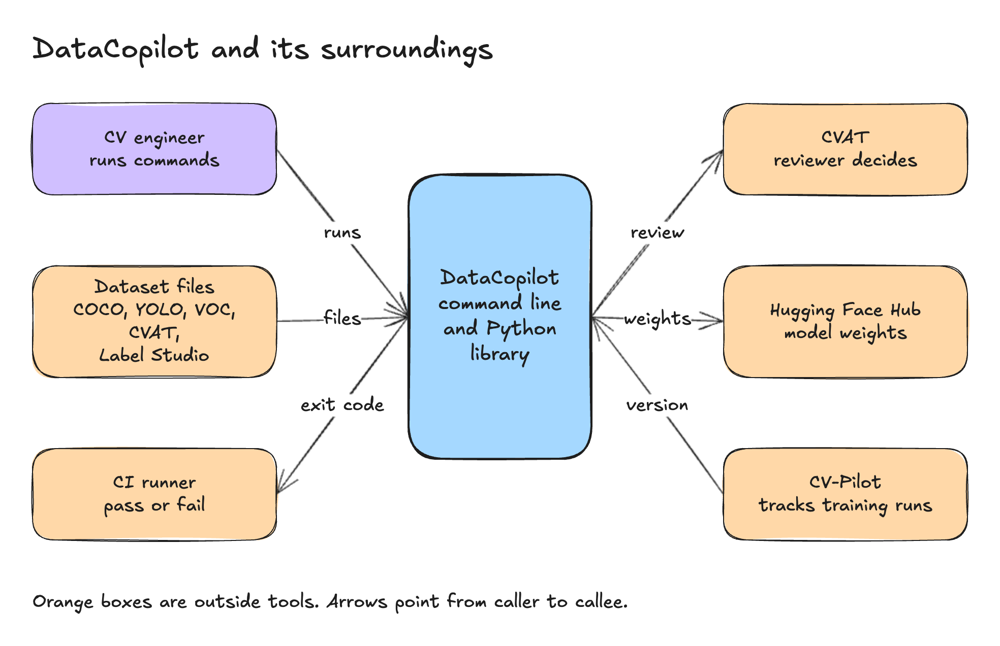

# 01 Overview

## Purpose

DataCopilot turns a dataset export into a versioned folder (`dataset.dcp/`), audits it with
reproducible checks, converts it to other formats without silent loss, and can propose boxes your
labels missed for a person to review. It is a command-line tool and a Python library. It runs in one
process, on the CPU, without a server. See [Status](../status.md) for what runs today.

## Users

| Who | What they do |
|---|---|
| CV engineer | Ingests an export, audits it, fixes leaks and box errors, re-splits, exports YOLO for training. |
| Label reviewer | Accepts or rejects proposed boxes in CVAT. Never runs DataCopilot. |
| CI maintainer | Adds `datacopilot audit --fail-on leakage,critical` to a pipeline and blocks merges on exit code 1. |
| Plugin author | Packages a format, check, proposer or embedder as an entry point ([ADR-0005](../adr/0005-plugin-system.md)). |

## Scope

In scope: detection (axis-aligned boxes) and classification datasets; six formats with a round-trip
contract; the audit checks; group-aware re-splitting; `add_box` proposals with CVAT review; HTML,
JSON and SARIF reports; a content-hashed, append-only dataset version.

Out of scope:

- No GUI, annotation tool, dataset browser or hosted service.
- No training, no model serving.
- No automatic application of model output: every proposal goes through review.
- No polygons, masks, video or tracks (the schema reserves the field).
- No database server.

## Context

*DataCopilot talks to you, your files, CI, CVAT, the model hub and CV-Pilot.*

| Outside party | How it talks to DataCopilot |
|---|---|
| CV engineer | Runs `datacopilot ...` or `import datacopilot`. |
| Dataset files | COCO, YOLO, VOC, CVAT, Label Studio and ImageFolder files, read and written. |
| CI runner | Reads the exit code and `report.sarif`. |
| CVAT | Receives proposals as a review folder; its decisions come back as a file. |
| Hugging Face Hub | Source of model weights, downloaded over HTTPS. Nothing is redistributed. |
| CV-Pilot | Reads `manifest.json` to record the dataset version of a training run. |

## Quality goals

Reference input **R50k**: 50,000 JPEG images with 500,000 boxes in 200 classes, as COCO JSON on a
local disk. Budgets are goals; a release that misses one says so in the changelog.

| Goal | Budget | Checked by |
|---|---|---|
| Core install size | At most 250 MB, no `torch` or CUDA package. | `tests/release/test_core_dependencies.py` |
| CPU audit time | R50k, all CPU checks, at most 10 min on 8 cores. | `benchmarks/audit_cpu.py` |
| Embedding checks | R50k with cached vectors, at most 10 min. | `benchmarks/embed_checks.py` |
| Memory | R50k audit at most 4 GB; images are never decoded by the CPU checks. | `benchmarks/audit_cpu.py` |
| Determinism | Same input and options give the same tables, version and report. | golden tests |
| Round trip | Same-format read, write, read is field-identical. | `tests/golden/` |
| Exit codes | 0, 1, 2 and 130 as in [errors and logging](../engineering/errors-and-logging.md). | CLI tests |
| Logging | Every record has the seven required fields; secrets redacted. | `tests/unit/test_logging_contract.py` |

Measured on one machine (Apple M4 Pro, 12 cores, Python 3.13): the CPU audit of R50k took 37.6 s
with 1.35 GB peak memory, and the three embedding checks took about 21 s on synthetic vectors. The
conditions and the other numbers are in the
[changelog](https://github.com/B4teShai/DataCopilot/blob/main/CHANGELOG.md). Embedding 50,000 real
images on a GPU was not measured.

## Constraints

| Constraint | Source |
|---|---|
| Apache-2.0. Copyleft libraries never in core. | [ADR-0001](../adr/0001-scope-and-license.md) |
| CPU-only core. PyTorch and transformers only behind `embed` and `vlm`. | [ADR-0003](../adr/0003-repo-and-tooling.md) |
| Core dependencies are exactly `typer`, `click`, `pydantic`, `structlog`, `pyarrow`, `numpy`, `jinja2`. | [ADR-0003](../adr/0003-repo-and-tooling.md) |
| Python 3.10 or newer. | [standards](../engineering/standards.md) |
| No database server. Parquet files only. Images referenced, never copied. | [ADR-0006](../adr/0006-dataset-format.md) |
| Model weights are never vendored. | [ADR-0001](../adr/0001-scope-and-license.md) |
| Four layers, imports point downward. | [ADR-0004](../adr/0004-layering-and-dependency-rule.md) |
