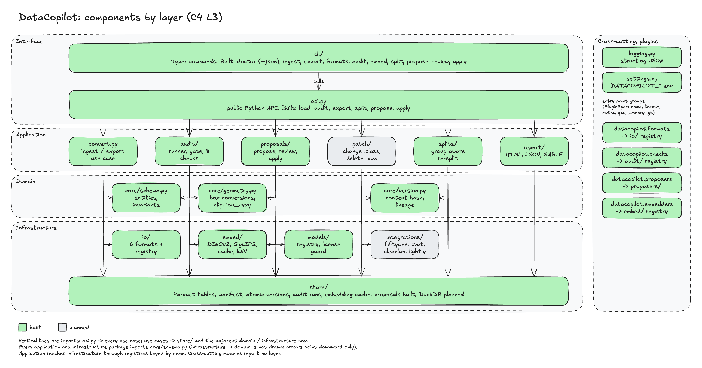

# 02 Components



Layers follow [ADR-0004](../adr/0004-layering-and-dependency-rule.md). Import package:
`datacopilot`. Built: `cli/` (`doctor`, `ingest`, `export`, `formats`, `audit`, `embed`, `split`, `propose`, `review export`, `review import`, `apply`), `convert.py`, `audit/` (registry, runner, gate and the checks `integrity`, `duplicates`, `imbalance`, `boxes`, `near_duplicates`, `leakage`, `label_noise`, `outliers`), `embed/` (protocol, registry, backends, cache, kNN), `models/` (registry, license guard), `proposers/` (protocol, registry, Grounding DINO, test proposer), `proposals/` (propose, review, apply use cases), `splits/` (group keys, assignment, the split use case), `report/` (JSON, HTML, SARIF), `core/`, `io/` (COCO, YOLO, VOC, CVAT XML, Label Studio, ImageFolder), `store/`, `doctor.py`, `api.py` (`load`, `audit`, `export`, `split`, `propose`, `apply`), `deprecation.py`, `logging.py`, `settings.py`. Everything else is planned.

| Layer | Packages |
|---|---|
| Interface | `cli/`, `api.py` |
| Application | `convert.py`, `audit/`, `proposals/`, `splits/`, `report/` |
| Domain | `core/schema.py`, `core/version.py`, `core/geometry.py` |
| Infrastructure | `io/`, `store/`, `embed/`, `models/`, `proposers/`, `integrations/` |
| Cross-cutting (beside the layers) | `logging.py`, `settings.py` |

## Interface layer

### `cli/`

Responsibility: Typer application; one command per use case; the single error boundary
(`main()`); maps exceptions to exit codes; `stdout` for results, `stderr` for logs.

Public interface (built):

```python
app: typer.Typer
def main() -> NoReturn                       # entry point `datacopilot`
def doctor(json_out) -> None                 # status + one line per section (or --json), logs doctor_completed; exit 0 / 1 / 2
# `datacopilot --version` prints "datacopilot <__version__>"
def ingest(path, format, output, group_by, name, strict) -> None   # prints manifest.version
def export(dataset, format, output, strict) -> None         # prints the output directory
def formats() -> None                                       # name, read/write, license, extra
def audit(dataset, checks, fail_on, report, json, sarif, workers, hash_cache,
          allow_external_images, embedder, embed_batch, similarity_threshold, embedding_cache,
          allow_test_embedder, require_cache_key,
          show_group_labels) -> None                        # prints one result line; exit 0 / 1 / 2
def embed(dataset, embedder, embed_batch, embedding_cache,
          require_cache_key) -> None                        # fills the cache; exit 0 / 1 / 2
```

Built commands: `ingest`, `export`, `formats`, `audit`, `embed`, `split`, `propose`, `review export`, `review import`, `apply` (exit codes in their `--help` and in
[04-flows.md](04-flows.md)). Planned command: `plugins`. Each is a thin function that validates options and calls one use case.
The built commands call `convert.py` and `audit/` directly (imported lazily so `--version` does not
load `pyarrow`); `api.py` wraps the same use cases for Python callers.

Depends on: `convert.py`, `audit/`, `doctor.py`, `logging.py`, `settings.py`. Status:
**built** for `doctor`, `ingest`, `export`, `formats`, `audit`, `embed`, `propose`, `review export`, `review import`, `apply`; the rest planned.

### `api.py`

Responsibility: the public Python API; stable names under semver. `datacopilot.__all__` is the
frozen surface, pinned by `tests/unit/test_api_surface.py`; `deprecation.deprecated` implements the
one-minor-version deprecation policy.

Built (thin wrappers over `convert.py` and `audit/`; same validation, limits and fail-closed rules
as the commands; a failed gate is recorded in `AuditRun.passed`, not raised):

```python
def load(path, format=None, *, group_by=None, strict=False) -> Dataset
def audit(dataset, checks="all", *, fail_on=("critical",), embedder=None, embed_batch=None,
          similarity_threshold=None, allow_test_embedder=False, root=None, workers=None,
          require_local_images=False, include_model_annotations=False) -> AuditRun
# AuditRun.raise_for_gate() raises GateFailedError when the recorded gate failed
def export(dataset, format, out, *, strict=False) -> ConversionReport
```

Planned (the design below; `load` and `audit` above are the built forms of the first two):

```python
def load(path: str, *, format: str | None = None, group_by: str | None = None,
         hash_images: bool = True) -> Dataset
def audit(ds: Dataset, *, checks: Sequence[str] | Literal["all"] = "all",
          embedder: str | None = None, fail_on: Sequence[str] = ()) -> AuditRun
def split(ds: Dataset, *, by_group: bool = True, ratios: tuple[float, float, float] = (0.8, 0.1, 0.1),
          stratify: Literal["category"] | None = "category", seed: int = 0) -> Dataset
def propose(dataset: str | Path, proposer: str = "grounding_dino", *, classes=None, min_score=0.35,
            class_min_score=None, time_budget_seconds=3600.0) -> ProposalSet   # stores the set in dataset.dcp
def apply(dataset: str | Path, proposals: str, out: str | Path, *, allow_incomplete: bool = False) -> DatasetManifest
class ProposalSet:   # core/proposals.py: frozen, content-addressed (set_id), see 03-data-model.md
    proposals: tuple[Proposal, ...]
    def accepted(self) -> tuple[Proposal, ...]
    def derive(self, proposals: Sequence[Proposal]) -> ProposalSet   # the reviewed successor
class Dataset:
    manifest: DatasetManifest
    def export(self, format: str, out: str, *, strict: bool = False) -> ConversionReport
```

Depends on: application packages, `core/`. Status: **built** for `load`, `audit`, `export`, `split` (returns a `SplitReport`), `propose`, `apply` and `ProposalSet`; FiftyOne helpers and `Dataset.export` planned. `propose` takes the path of a `.dcp` directory (the set is stored there); review is done with the command line.

## Application layer

### `convert.py`

Responsibility: `ingest` and `export` use cases: pick a reader or writer by name from the
`io/` registry, run it, validate rows against `core/schema.py`, write or read the store,
produce a `ConversionReport`.

```python
def ingest(source, format, out, *, group_by: str | None, name: str | None, limits) -> IngestResult
def export(ds: Dataset, format: str, out, *, strict: bool) -> ConversionReport
def parse_group_by(pattern: str) -> re.Pattern[str]
# ConversionReport lives in io/report.py (infrastructure, imported by name, not an adapter):
class ConversionReport(BaseModel):
    source_format: str; target_format: str
    rows_read: int; rows_written: int
    dropped: dict[str, int]            # column -> number of values the target could not hold
    skipped: dict[str, int]            # reason -> number of rows left out (e.g. images.file_missing)
    def is_lossless(self) -> bool      # nothing dropped and nothing skipped
```

`ingest` always hashes image bytes (`image_id`), so the planned `hash_images` switch is not
exposed. `export` writes into a sibling temporary directory and renames it into place only
after `--strict` is satisfied; the output directory must be absent or empty. Events:
`dataset_ingested`, `dataset_exported`, and one `conversion_loss` (WARN) per dropped or
skipped column.

Depends on: `core/`, `io.registry` and `io.report`, `store/`. Status: **built**.

### `audit/`

Responsibility: run checks, collect `Finding` rows into an `AuditRun`, evaluate
`--fail-on`. Checks live in `audit/checks/` and register through the entry-point group
`datacopilot.checks` (`audit/registry.py`, lazy, duplicate names rejected); each is an object with
`spec: PluginSpec` and `run`. Persistence is the store's job (`DatasetStore.write_audit`).

```python
class Check(Protocol):
    spec: PluginSpec
    def run(self, ds: Dataset, ctx: CheckContext) -> list[Finding]
class CheckContext(BaseModel, frozen=True):
    run_id: str; root: Path; cache_dir: Path; workers: int; embedder: str | None
    embeddings: EmbeddingProvider | None; dataset_dir: Path | None   # the embedding checks' input
    use_hash_cache: bool; cache_key: SecretStr | None; in_ci: bool
    allow_external_images: bool; require_local_images: bool; incomplete_is_critical: bool
    config: CheckConfig   # thresholds and budgets (max_unchecked_fraction, max_check_seconds, max_hash_bytes,
                          # near_duplicate_cosine, leakage_cosine, knn_k, outlier_*, suspect_*, max_suspects_per_*, max_embed_image_bytes)
def run_audit(ds: Dataset, checks: Sequence[str] | Literal["all"], ctx: CheckContext,
              fail_on: Sequence[str] = ()) -> AuditRun
def gate_failed(run: AuditRun, fail_on: Sequence[str]) -> bool   # True -> exit code 1
```

Built checks and findings (`payload["rule"]`):

| Check | Severity | Rules |
|---|---|---|
| `integrity` | CRITICAL / WARN / INFO | `file_missing`, `unsafe_path`, `not_a_regular_file`, `unreadable`, `empty_file`, `invalid_header` (also an unrecognised format: ingest accepted every image, so a file that no longer parses was damaged or replaced), `size_mismatch`, `audit_incomplete` (time budget reached; WARN when no gate is applied) (CRITICAL); `file_too_large`, `truncated_file` (WARN: a JPEG, PNG or GIF whose last 4 KiB lack the end marker); `remote_not_checked`, `external_not_checked` (WARN, CRITICAL above `max_unchecked_fraction` = 50 percent of the images or with `--require-local-images`); `exif_orientation` (INFO). Header only (PNG, JPEG, GIF, BMP with DIB header size checked), never a full decode |
| `duplicates` | CRITICAL across train/val/test or between `unassigned` and a real split, WARN within one split | `exact_duplicate` (one finding per group, `group_id` = 12-hex digest prefix), `content_changed` (CRITICAL: the file no longer hashes to `image_id`), `audit_incomplete` (CRITICAL; time or byte budget reached), `hash_cache_mismatch` (WARN), `images_not_hashed` (WARN, CRITICAL like `remote_not_checked`; counts by reason) |
| `imbalance` | WARN / INFO | `long_tail` (per split: ratio `max/min` over present classes, effective number of classes `exp(H)`), `class_missing_in_split`, `class_unused` |
| `near_duplicates` | WARN within a split, CRITICAL across splits | `near_duplicate` (cluster of images whose embeddings have cosine similarity of at least `near_duplicate_cosine` = 0.95 among each other's 10 nearest neighbours; `cross_split` clusters are CRITICAL like exact duplicates, and `leakage` reports them too; `group_id` = 12-hex digest of the member ids, up to 20 members as short id, split and base name), `phash_not_applied` (WARN; optional perceptual-hash prefilter could not hash some images, their pairs are kept; the prefilter never drops a cross-split pair and weakens the within-split gate), `embedding_pair_contradicted` (WARN) |
| `leakage` | CRITICAL | `cross_split_near_duplicate` (neighbours are searched only among the images of the *other* splits, so a crowd of same-split frames cannot hide a leak; `unassigned` is compared with the real splits like in `duplicates`), `group_overlap` (one `group_id` in more than one split; needs no embedding) |
| `outliers` | INFO | `outlier` (per class, mean cosine distance to the 5 nearest images of the same class, robust z above 3.5 with the scale floored at 0.02; at most 20 per class), `classes_skipped`, `images_without_class` |
| `label_noise` | INFO; WARN or CRITICAL for unscored boxes; WARN or INFO for `skipped` | `suspect_class` (a box of class `c` when at most `suspect_max_support` = 0.0 of its usable neighbours carry `c`: the 10 nearest embedded and annotated photos at cosine similarity of at least 0.3, at least 3 usable, else the box is counted in `annotations_not_scored` (WARN; CRITICAL above `max_unchecked_fraction` of the boxes or with `--require-local-images`); at most 3 per photo, 20 per class and 50,000 in all, the rest in `suspects_truncated` (INFO); at most 256 classes of one photo count as carried, the photos cut are in `classes_truncated` (INFO); evidence: support, neighbours, mean similarity, the 5 classes the neighbours carry), `skipped` (`reason`: WARN for `embedder_missing`, `no_embeddings`, `too_many_images`, `too_few_images`; INFO for `no_annotations`, `single_class`). Measured weak, see [ADR-0009](../adr/0009-label-noise-check.md). Built since [ADR-0010](../adr/0010-split-and-box-crops.md): by default the neighbours are **box crops** (`audit/crops.py`: boxes of at least 32 pixels on the shorter side, 0.1 padding, at most 50 per image, cached under a geometry variant), the photo rule above is `suspect_basis = "image"` and the reported fallback (`crop_rule_unavailable`, WARN), every finding names its `basis`, `annotations_not_scored` carries `reasons`, and `too_few_boxes` joins the `skipped` reasons. Still weak |
| `boxes` | CRITICAL / WARN | `invalid_box`, `out_of_bounds`, `zero_area` (CRITICAL); `tiny_box`, `extreme_aspect`, `duplicate_box` (earliest same-class match), `conflicting_class` (earliest different-class match; one box can be both), `pairwise_skipped` (WARN: an image with more than 20,000 boxes) (WARN); `boxes_truncated` (INFO) |

The four embedding checks share these **fail-closed rules**, emitted by each of them so that
`--fail-on <check>` and the severity gates see them: `embedder_missing` (CRITICAL, no provider),
`embedder_error` (CRITICAL; the exception *type* only, never its text), `images_not_embedded`
(`leakage`: CRITICAL under a gate for any image not embedded except by time budget, WARN without a
gate; the others: WARN, CRITICAL above `max_unchecked_fraction` or with `--require-local-images`;
counts by reason
`remote`, `outside_root`, `unsafe_path`, `file_missing`, `not_a_regular_file`, `unreadable`,
`file_too_large`, `content_changed`, `decode_failed`, `too_many_pixels`, `multi_frame`, `zero_vector`,
`embedder_error`, `time_budget`), `audit_incomplete` (embedding time budget, neighbour search time
budget, more than 500,000 images, or more than 2,000,000 similar pairs: `pair_cap`), `embedding_pair_contradicted` (fresh vectors reversed a verdict made from cached ones),
`embedding_cache_rejected`, `embedding_cache_mismatch`, `embedding_cache_content_changed` (an
image file no longer hashes to the digest stored with its cached vector; the cache is discarded) and
`embedding_cache_unverified` (WARN). `leakage` also reports `images_without_group` (INFO, when only
some images carry a `group_id`, so that clearing the id on the images that matter is visible; a
dataset with no group ids at all cannot be told apart from one that does not use them). `--checks all` includes the four only when an embedder is given; naming one without
`--embedder`, or gating on one that is not part of the run, is a usage error (exit 2).
`sku_confusion` is planned (and the Cleanlab backend of `label_noise`); `--fail-on` rejects its name as "not available
in this version" instead of accepting a gate that can never fire.

`--fail-on` defaults to `critical` at the CLI; `none` (alone) applies no gate. It accepts severity names and check names. A severity name is a threshold: `warn` matches
WARN and CRITICAL, `info` matches everything. A check name matches every finding of that check.
Unknown tokens, empty tokens and check names that are not part of the run are usage errors (exit
code 2).

Run rules: an empty dataset (no images) is refused; plugin code that raises `SystemExit` or any `BaseException` other than `KeyboardInterrupt` fails the audit (exit 1) instead of ending the process; file-reading checks use a bounded window of futures (`audit/pool.py`) and a per-check time budget; checks run in registry order (`integrity`, `duplicates`, ... then third-party names
alphabetically); each check's output is re-validated (Pydantic), must carry this run's id and the
check's name and may reference only images and annotations of the audited dataset; identical keys
collapse to the most severe finding; each check is capped at `MAX_FINDINGS_PER_CHECK` (50,000)
with a `findings_truncated` finding that carries the highest dropped severity, so a gate never
changes because of the cap; findings are ordered by severity, image, annotation, id. Image
paths are classified in `audit/paths.py` (remote, unsafe, external, local) and opened with
`O_NOFOLLOW` after being resolved inside the dataset root ([06-cross-cutting.md](06-cross-cutting.md)).
`audit/hashcache.py` is the authenticated hash cache.

Depends on: `core/`, `io.files` and `io.registry` (header reader, path helpers; never an
adapter module), `logging.py`. The tables arrive as a `Dataset` read through the bounded store
reader; DuckDB is not used (see [ADR-0003](../adr/0003-repo-and-tooling.md)). Hashing and header
reads run on a thread pool (`hashlib` releases the GIL on large chunks), not a process pool.
Status: **built** for the registry, runner, gate, the four CPU checks and the four embedding
checks (`near_duplicates`, `leakage`, `label_noise`, `outliers`) with `audit/embedding.py`, the pipeline that feeds
them (cache, bounded reads, batching, spot check, budgets), and `audit/crops.py`, the same pipeline for box crops.

### `splits/`

Responsibility: group-aware, optionally stratified re-split that writes a new dataset version. Named
`splits` so that importing it never shadows the `datacopilot.split` function.

```python
# splits/groupkey.py
def parse(text: str) -> GroupKey                 # group_id | source.<name> | re:<safe pattern>
def key_of(image: Image, key: GroupKey) -> str | None
# splits/assign.py
def assign(groups: Sequence[Group], ratios: Ratios, *, seed: int, stratify: bool = False) -> Assignment
# splits/usecase.py
def split_dataset(dataset: Path, out: Path, *, settings, ratios, group_key="group_id",
                  near_duplicates=False, embedder=None, similarity_threshold=None,
                  embed_batch=None, stratify=False, seed=0) -> SplitReport
```

Groups are connected components of "same key" and, with near duplicates, every pair found by
`embed/knn.pairs_at_least` (exact, upper triangle, pair cap). Invariant: no group, and so no `group_id`,
appears in two splits; checked after the assignment. Depends on: `core/`, `store/`, `embed/` and the
audit's embedding pipeline. Status: **built** ([ADR-0010](../adr/0010-split-and-box-crops.md)).

### `proposals/` and `proposers/`

Responsibility: `proposals/` holds the use cases; `proposers/` (infrastructure) holds the models
behind a registry. Built:

```python
# proposers/protocol.py (infrastructure)
class Proposer(Protocol):
    model_id: str; revision: str; weights: dict[str, str]
    def detect(self, image: bytes, phrases: Sequence[str], size: tuple[int, int], *, min_score: float) -> list[Candidate]
# proposals/run.py
def propose(ds: Dataset, proposer: Proposer, *, proposer_name: str, root: Path, classes=None,
            min_score=0.35, class_min_score=None, overlap_iou=0.5, time_budget_seconds=3600.0) -> ProposalSet
# proposals/review.py
def export_review(ds: Dataset, ps: ProposalSet, out: Path) -> ConversionReport     # CVAT, proposals as a layer
def import_review(ds: Dataset, ps: ProposalSet, directory: Path) -> tuple[ProposalSet, ReviewSummary]
# proposals/apply.py
def apply_proposals(ds, ps, out, *, allowed_licenses, allow_incomplete=False, source=None, limits=None) -> DatasetManifest
```

Proposers: `grounding_dino` (Grounding DINO tiny, extra `[vlm]`) and the test-only `test_boxes`.
`propose` validates every candidate a model returns (finite, inside the image, a label that was
asked for), drops what already exists (same class, IoU 0.5) and marks an incomplete run. Review goes
through the CVAT reader and writer; `apply` creates a new dataset with `DatasetStore.create` and never
touches an existing version. Depends on: `core/`, `store/`, `io.registry`, `convert.py`,
`audit.embedding` (the contained image reader), `proposers/` through its registry. Status: **built**
for `add_box` proposals. `change_class`, `delete_box`, `refine_box`, consensus between models, SAM 3,
Qwen3-VL and FiftyOne review are planned; see [ADR-0008](../adr/0008-propose-review-apply.md).

### `report/`

Responsibility: render an `AuditRun` to JSON, a static HTML page and SARIF 2.1.0.

```python
def render(run: AuditRun, *, html: Path | None, json: Path | None, sarif: Path | None) -> list[Path]
```

The HTML page (Jinja2, autoescaping always on, sandboxed environment) has a score card, the checks
with timings, a class histogram (inline SVG), a split-by-class table and the findings table
(sorted by severity across all checks, then capped at 2,000 rows with the omitted count per severity; thumbnails omitted; the headline says "no gate applied" when `--fail-on none` was used); the data comes from the run itself
(`AuditRun.summary` holds the per-split class counts). It has no script, no event-handler or
`style` attributes, no links or remote resources, and a `Content-Security-Policy` meta tag that
allows only the one inline stylesheet by its SHA-256 hash. SARIF results carry relative
base names only (percent-encoded, relative to the symbolic base `DATASET_IMAGES`; no repository path is invented) plus logical locations, are sorted by severity and capped at 5,000 with a summary result, `automationDetails.id` is the stable `datacopilot/audit/` with the run id as `correlationGuid`, rule ids
`<check>/<rule>` restricted to `[a-z0-9_]`, and `partialFingerprints.findingId/v1`. Every
dataset-derived string is cleaned by `report/text.py` (control, bidirectional and zero-width
characters shown as `\uXXXX`, bounded length); JSON and SARIF are ASCII. Files are written to a
temporary sibling and renamed into place. Not yet in the report: split-by-class heatmap colours,
leakage graph, near-duplicate clusters, box histograms, SKU confusion, proposer precision (their
checks are planned).

Depends on: `core/`, `logging.py`. Status: **built** (JSON, HTML, SARIF).

## Domain layer

### `core/schema.py`

Responsibility: Pydantic models for `Category`, `Image`, `Annotation`, `DatasetManifest`,
`AuditRun`, `Finding`, `Embedding`, `PluginSpec`, and the invariants in
[03-data-model.md](03-data-model.md); `core/proposals.py` holds `Proposal` and `ProposalSet`. Imports
only the standard library, `pydantic`, `numpy`. Status: **built** for `Category`, `Image`, `Annotation`, `DatasetManifest`,
`PluginSpec`, `Dataset`, `validate_tables` (cross-row invariants), `Finding`, `AuditRun`, `Counts`
and `Summary`; `Proposal` and `ProposalSet` (`core/proposals.py`) are built and `Embedding` is a store of verified shards. Exceptions live in `core/errors.py`
(`DataCopilotError`, `FormatError`, `ValidationError`, `StoreError`, `ConversionLossError`).

### `core/version.py`

```python
def table_hash(rows: Iterable[Mapping[str, object]], *, exclude: frozenset[str] = frozenset()) -> str
def dataset_version(images, annotations, categories, *, schema_version: int) -> str
def extend_lineage(parent: DatasetManifest, child_version: str) -> tuple[str, ...]
def models_version(images, annotations, categories, *, schema_version: int) -> str   # over model rows
```

Status: **built** (golden test with an independent oracle in `tests/golden/`).

### `core/geometry.py`

```python
def iou_xyxy(a: NDArray[np.float64], b: NDArray[np.float64]) -> NDArray[np.float64]   # (n,4),(m,4) -> (n,m)
def clip_to_image(boxes: NDArray[np.float64], width: int, height: int) -> NDArray[np.float64]
def to_cxcywh_norm(boxes_xyxy_abs, width, height) -> NDArray[np.float64]
def from_cxcywh_norm(boxes, width, height) -> NDArray[np.float64]
def rescale_grid(boxes_0_1000: NDArray[np.float64], width: int, height: int) -> NDArray[np.float64]  # Qwen3-VL output
```

Built today, on plain 4-tuples (no NumPy dependency): `xywh_to_xyxy`, `xyxy_to_xywh` (exact
inverse for boxes produced by `xywh_to_xyxy`), `xyxy_to_cxcywh_norm`, `cxcywh_norm_to_xyxy`,
`xyxy_to_norm`, `norm_to_xyxy`, `clip_to_image`. `iou_xyxy` (NumPy, imported inside the function so the tuple helpers stay import-light) is
**built** and used by the `boxes` check; `rescale_grid` and the other array variants are planned.

## Infrastructure layer

### `io/`

Responsibility: one module per format (`coco`, `yolo`, `voc`, `cvat_xml`, `labelstudio`,
`imagefolder`) and `registry.py`. Readers yield rows and keep unmapped fields in
`source`; writers re-emit them where the target allows.

```python
class ReadResult:                           # rows plus what the reader could not carry
    name; task; images; annotations; categories; dropped: dict[str, int]; skipped: dict[str, int]
class Reader(Protocol):
    spec: PluginSpec
    def read(self, path: Path) -> ReadResult
class Writer(Protocol):
    spec: PluginSpec
    def write(self, ds: Dataset, out: Path) -> ConversionReport   # `out` is an existing empty directory
def get_reader(name: str) -> Reader      # resolves lazily; raises FormatError naming the extra if missing
def get_writer(name: str) -> Writer
def list_formats() -> list[FormatInfo]   # sorted; name, read/write capability, license, extra
```

Built formats and their rules are in [03-data-model.md](03-data-model.md#format-mapping-and-loss-matrix).
Format modules import only the standard library and `core/`; `xmlsafe.py` parses XML from
`expat` events with DOCTYPE and entity declarations rejected; `miniyaml.py` parses the
`data.yaml` subset; `files.py` holds bounded reads, path containment, a regular-file-only non-blocking open and
image-header parsing (`image_header`: format, stored size, EXIF orientation; reused by the
`integrity` check). Depends on: `core/`. Status: **built** for `coco`, `yolo`, `voc`, `cvat_xml`, `label_studio`, `imagefolder` and
`registry`. `cvat_xml.py` and `labelstudio.py` also read through bounded descriptors with element, depth,
attribute, task and result caps and count every unsupported shape.

### `store/`

Responsibility: `dataset.dcp/` layout, Arrow schemas, DuckDB queries, atomic snapshot
writes, embedding cache keyed by (`image_id`, `model_id`, `model_revision`).

```python
class DatasetStore:
    @classmethod
    def open(cls, path, *, limits: StoreLimits | None = None) -> DatasetStore
    @classmethod
    def create(cls, path, images, annotations, categories, *, name, task, limits=None, lineage=()) -> DatasetStore
    def manifest(self) -> DatasetManifest
    def read(self, *, verify: bool = True) -> Dataset    # bounded, batched, hash-verified
    def write_version(self, images, annotations, categories) -> DatasetManifest   # parent = current
    def query(self, sql: str) -> pyarrow.Table           # planned: read-only DuckDB over the tables
    def write_audit(self, run: AuditRun) -> Path
    def write_proposals(self, ps: ProposalSet) -> Path                          # proposals/<set_id>.json
    def read_proposals(self, set_id: str) -> ProposalSet                        # digest-checked
    def embeddings(self, model_id: str, revision: str) -> pyarrow.Table | None
```

Depends on: `core/`, `pyarrow` (`duckdb`, `fsspec` arrive with audit). Status: **built**:
`create`, `open`, `read`, `write_version`, atomic writes, refuse-to-overwrite, resource limits
([06-cross-cutting.md](06-cross-cutting.md)). `write_audit` and `read_audit` (`audits/<run_id>.json`, atomic, UUID-named, symlink-safe, bounded
read) and `write_proposals` and `read_proposals` (`proposals/<set_id>.json`, content-addressed, bounded read at 128 MiB,
symlink-safe) are **built**; `query` is planned.

### `embed/`

Responsibility: embedder backends (`dinov2`, `dinov3`, `siglip2`), batch decode, cache,
FAISS index for kNN.

```python
class Embedder(Protocol):
    spec: PluginSpec
    def embed(self, images: Iterable[Image], *, batch_size: int) -> NDArray[np.float32]   # (n, dims)
def knn(queries, base, k, *, same_set=False, backend="auto") -> tuple[NDArray[np.int64], NDArray[np.float32]]
def iter_knn(queries, base, k, *, same_set=False, backend="auto", deadline=None) -> Iterator[KnnBlock]
```

Depends on: `core/`, `models/`, `[embed]` extra inside functions. Status: the `Embedder` and
`EmbedderPlugin` protocols and the registry (`embed/protocol.py`, `embed/registry.py`) are **built**;
the backends (`embed/backends.py`: `dinov2_small`, `dinov2_base`, `siglip2_base`), the bounded image
decoder and preprocessing (`embed/imaging.py`), the `hash` test embedder (`embed/hashembed.py`) and
the cache (`embed/cache.py`) and the exact kNN index (`embed/knn.py`) are **built**.

Deviation from the first design: `embed` takes encoded image bytes (`Sequence[bytes]`), not `Image`
rows. The caller resolves every path inside the dataset root, opens it with `O_NOFOLLOW`, bounds its
size and hands the bytes over, so path containment lives in one reviewed place and a plugin is a pure
function from bytes to vectors. Embedder names are `snake_case` (`dinov2_base`) because `PluginSpec.name`
is; a hyphen is not accepted.

### `models/`

Responsibility: model registry: id, Hugging Face repo, revision, license (SPDX or custom
name), gated flag, GPU memory hint; the license guard against
`DATACOPILOT_ALLOWED_LICENSES`; weight hash recording.

```python
class ModelCard(BaseModel, frozen=True):
    model_id: str; repo: str; revision: str; license: str; gated: bool; gpu_memory_gb: float | None
def get_model(model_id: str, allowed_licenses: frozenset[str]) -> ModelCard   # raises LicenseError
def weight_hash(local_path: Path) -> str
```

Cards pin a full 40-hex revision and the sha256 of each safetensors file (the registry cannot name a
pickle checkpoint). `get_model` raises `LicenseError` before any download or load; the allow-list is
compared case-insensitively. Status: **built** (`dinov2_small`, `dinov2_base`, `siglip2_base` and the
detector `grounding_dino`; DINOv3 and SAM cards are not registered). The `ModelCard` also carries `dims`
(None for a detector), `family`, and `aux_sha256` (tokenizer and processor files, `.json` and `.txt`
only) that are verified like the weights.

### `integrations/`

Responsibility: adapters to external tools: `fiftyone` (to/from FiftyOne, tags for
findings, a separate `Detections` field for proposals), `cvat` (pre-annotated tasks via
`cvat-sdk`, attributes preserved), `cleanlab` (confident-learning backend for the
`label_noise` check; `[cleanlab]` extra, AGPL-3.0, imported lazily inside the adapter
function; the check's `--help` states that using the extra makes the combined work
subject to AGPL-3.0), `lightly` (COCO-plus-folder export), `supervision` (fallback
reader). Each adapter imports its dependency inside the function and names the extra on
failure. Status: planned.

## Cross-cutting

- `logging.py` (**built**): structlog processor chain per
  [errors-and-logging.md](../engineering/errors-and-logging.md).
- `settings.py` (**built**): `Settings` from `DATACOPILOT_ENV`, `DATACOPILOT_LOG_LEVEL`;
  planned fields in [05-runtime.md](05-runtime.md).

## Registries and the plugin contract

Four entry-point groups, one registry each ([ADR-0005](../adr/0005-plugin-system.md)):

| Entry-point group | Registry module | Provides |
|---|---|---|
| `datacopilot.formats` | `io/registry.py` | `Reader` and/or `Writer` |
| `datacopilot.checks` | `audit/registry.py` | `Check` |
| `datacopilot.proposers` | `proposers/registry.py` | `Proposer` |
| `datacopilot.embedders` | `embed/registry.py` | `Embedder` |

Every plugin object exposes:

```python
class PluginSpec(BaseModel, frozen=True):
    name: str  # unique within its group, snake_case
    kind: Literal["format", "check", "proposer", "embedder"]
    license: str  # SPDX id, e.g. "Apache-2.0"; custom names allowed for weights
    extra: str | None  # pip extra that provides the dependency, e.g. "embed"
    gpu_memory_gb: float | None  # None = CPU
    version: str
```

Registries resolve by name on first use, read `spec` before importing the implementation,
reject duplicate names, and refuse to load a plugin whose `license` is outside
`DATACOPILOT_ALLOWED_LICENSES`. Plugin output is validated against `core/schema.py`.

First-party registration (`pyproject.toml`, built for the four format plugins):

```toml
[project.entry-points."datacopilot.formats"]
coco = "datacopilot.io.coco:plugin"
```

## Dependency rule in this project

Imports point downward only; reviewers reject the following:

- `core/*` importing anything from `datacopilot` outside `core/`, or importing `torch`,
  `duckdb`, `pyarrow`, `fsspec`, `PIL`.
- `io/`, `store/`, `embed/`, `models/`, `proposers/`, `integrations/` importing `cli/`, `api.py`,
  `audit/`, `split/`, `proposals/`, `report/`, `convert.py`.
- `audit/`, `proposals/`, `split/`, `report/`, `convert.py` importing
  `datacopilot.io.coco` (or any adapter module) directly; they call
  `io.registry.get_reader("coco")`.
- `cleanlab`, `ultralytics`, `cleanvision` or another copyleft package imported anywhere
  except inside the adapter function in `integrations/` that its extra exists for; never
  at module top level, never from `core/` or the application layer.
- `torch`, `transformers`, `faiss`, `fiftyone`, `cvat_sdk` at module top level anywhere;
  they are imported inside the function that needs them.
- `logging.py` or `settings.py` importing any layer.

The graph is enforced by `tests/unit/test_layering.py`, which reads every module's imports
(no `import-linter` dependency yet; ADR-0004 allows adding it later).
