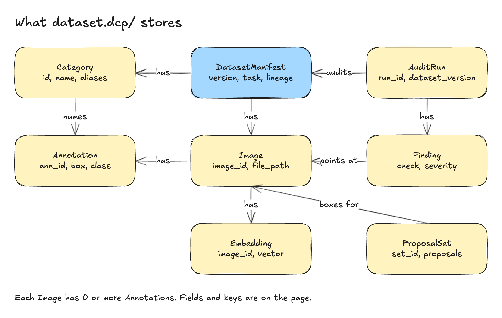

# 03 Data model



`Category`, `Image`, `Annotation`, `DatasetManifest`, `AuditRun` and `Finding` are built, and the
embedding cache (`Embedding`) is built as a store of verified shards; `Proposal` is planned. Models are Pydantic v2 in `core/schema.py`; tables are Parquet with explicit Arrow schemas
([ADR-0006](../adr/0006-dataset-format.md)). `?` after a type means nullable.

## Entities

### Category

Table `categories.parquet`. Primary key: `id`. Unique: `name`.

| Field | Type | Nullable | Meaning |
|---|---|---|---|
| `id` | int | no | Stable category id; source ids preserved where the source has them |
| `name` | str | no | Display name, unique within the dataset |
| `aliases` | list[str] | no (may be empty) | Synonyms; reused as text prompts for proposers |
| `attributes` | dict[str, str] | no (may be empty) | Free metadata, e.g. `{"sku": "...", "brand": "..."}` |

### Image

Table `images.parquet`. Primary key: `image_id`.

| Field | Type | Nullable | Meaning |
|---|---|---|---|
| `image_id` | str (16 hex) | no | `sha256(bytes)[:16]`; content-based, location-independent |
| `file_path` | str | no | Local path or `fsspec` URI; never a copy |
| `width` | int | no | Pixels, after EXIF orientation |
| `height` | int | no | Pixels, after EXIF orientation |
| `split` | enum `train\|val\|test\|unassigned` | no | Default `unassigned` |
| `group_id` | str | yes | Session, device, video or SKU group used by leakage checks and re-split |
| `source` | dict | no (may be empty) | Original format and ids, plus unmapped fields, verbatim |

### Annotation

Table `annotations.parquet`. Primary key: `ann_id`. Foreign keys: `image_id → Image`,
`category_id → Category`.

| Field | Type | Nullable | Meaning |
|---|---|---|---|
| `ann_id` | str | no | Unique within the dataset; derived from source id or generated |
| `image_id` | str | no | Owning image |
| `category_id` | int | no | Category |
| `kind` | enum `bbox\|classification` | no | Polygon and mask are reserved for later |
| `bbox_xyxy_abs` | float[4] | yes | Absolute pixel `x_min, y_min, x_max, y_max`; null for classification |
| `score` | float | yes | Prediction confidence; null for human labels |
| `is_crowd` | bool | no | COCO `iscrowd` |
| `occluded` | bool | yes | From VOC/CVAT flags |
| `truncated` | bool | yes | From VOC flags |
| `attributes` | dict[str, str \| int \| float \| bool] | no (may be empty) | Format attributes, e.g. CVAT attributes |
| `provenance` | enum `human\|model\|proposal_accepted` | no | Who produced the row |
| `source` | dict | no (may be empty) | Unmapped source fields, verbatim |

### DatasetManifest

File `manifest.json` (and a copy under `versions/<version>/`). Primary key: `version`.

| Field | Type | Nullable | Meaning |
|---|---|---|---|
| `version` | str (32 hex) | no | Content hash of the three tables; the value CV-Pilot records |
| `schema_version` | int | no | Table schema generation, starts at 1 |
| `name` | str | no | Human name |
| `task` | enum `detection\|classification` | no | Governs which checks apply |
| `categories` | list[Category] | no | Denormalised copy for readers without Parquet |
| `lineage` | list[str] | no (may be empty) | Parent versions, oldest first; each is a `version` |
| `image_count` | int | no | Number of rows in `images.parquet`; must equal the table (checked on read) |
| `annotation_count` | int | no | Number of rows in `annotations.parquet`; must equal the table (checked on read) |
| `created_at` | datetime (UTC) | no | Not part of the hash |

### Proposal

Table `proposals/<set_id>.parquet`. Primary key: `proposal_id`. Foreign keys:
`target_ann_id → Annotation` (nullable), `image_id → Image`.

| Field | Type | Nullable | Meaning |
|---|---|---|---|
| `proposal_id` | str | no | Unique |
| `set_id` | str | no | One per `propose` run; `latest` resolves to the newest set |
| `kind` | enum `add_box\|change_class\|refine_box\|delete_box\|flag_ambiguous` | no | What `apply` does |
| `target_ann_id` | str | yes | Null only for `add_box` |
| `image_id` | str | no | Image the proposal concerns |
| `payload` | dict | no | `bbox_xyxy_abs`, `category_id`, or note, depending on `kind` |
| `model_id` | str | no | Registry id |
| `model_revision` | str | no | Hub revision or local tag |
| `weight_hash` | str | no | sha256 of the weight file(s) |
| `prompt_hash` | str | no | sha256 of the prompt text |
| `score` | float | no | Model confidence after consensus |
| `evidence_crop_uri` | str | yes | Crop shown to reviewers |
| `status` | enum `pending\|accepted\|rejected` | no | Set by review import; default `pending` |
| `reviewer_id` | str | yes | From the review tool |

### AuditRun

File `audits/<run_id>.json`. Primary key: `run_id`. Foreign key: `dataset_version →
DatasetManifest.version`.

| Field | Type | Nullable | Meaning |
|---|---|---|---|
| `run_id` | str (UUID) | no | Equals the CLI `request_id` of the invocation |
| `dataset_version` | str | no | Version audited |
| `started_at` | datetime | no | UTC |
| `checks` | list[str] | no | Check names that ran |
| `embedder` | str | yes | Embedder used, if any |
| `counts` | dict `{critical, warn, info}` | no | Totals |
| `passed` | bool | no | `False` when `--fail-on` matched |
| `fail_on` | list[str] | no (may be empty) | The gate that was evaluated, lower case; not in the first design, added so a report states its own verdict |
| `timings_ms` | dict[str, int] | no (may be empty) | Wall time per check, in run order; excluded from the determinism contract |
| `summary` | Summary? | yes | Totals, images per split and annotations per (split, class id), so reports need only the run; omitted per-class detail when the dataset has more than 2,000 classes |
| `findings` | list[Finding] | no | Embedded in the JSON file |

### Finding

Embedded in `AuditRun.findings`. Primary key: `finding_id`. Foreign keys: `run_id →
AuditRun`, `image_id → Image` (nullable), `ann_id → Annotation` (nullable).

| Field | Type | Nullable | Meaning |
|---|---|---|---|
| `finding_id` | str | no | Deterministic: `sha256(canonical JSON of check, image_id, ann_id, payload)[:16]`; the run and the severity are not part of the key, so reruns dedupe and the model rejects a forged id |
| `run_id` | str | no | Owning run |
| `check` | str | no | Check name |
| `severity` | enum `CRITICAL\|WARN\|INFO` | no | Gate input |
| `image_id` | str | yes | Image concerned, if any |
| `ann_id` | str | yes | Annotation concerned, if any |
| `payload` | dict | no | Check-specific data (strings are cut to 512 characters, never aborting the audit) (`rule`, pair ids, IoU, counts). Bounded: at most 65,536 bytes of canonical JSON, depth 6, 20,000 values, finite numbers only |

### Embedding

Cache directory `embeddings/<model_id>@<model_revision>/` holding `manifest.json` and one or more
`shard-<32 hex>.parquet` files ([ADR-0007](../adr/0007-embedding-cache-and-index.md)). The logical
key is (`image_id`, `model_id`, `model_revision`); the model identity lives in the manifest, so a
shard row has only two columns. Foreign key: `image_id → Image`.

Shard columns (Parquet, zstd, one row group):

| Field | Type | Nullable | Meaning |
|---|---|---|---|
| `image_id` | str (16 hex) | no | Image; unique within the cache |
| `vector` | list<float16 \| float32> | no | Exactly `dims` finite values, L2 norm 1 (within 1e-3 for float16, rounding documented in ADR-0007) |
| `content_sha256` | str (64 hex) | no | Full sha256 of the image bytes the vector was computed from; a vector whose file no longer hashes to it is recomputed |

Manifest (`manifest.json`, at most 4 MiB, strict schema):

| Field | Meaning |
|---|---|
| `format` | `2` (shards carry `content_sha256`; the MAC key has a domain label) |
| `model_id`, `revision`, `dims`, `dtype` | The identity the vectors belong to; `dtype` is `float16` or `float32` |
| `preprocess` | Version of the decoding and preprocessing code; another version is stale |
| `dataset_version` | `manifest.version` the vectors were computed for; a cache for another version is ignored (stale) |
| `weights` | `file -> sha256` of the model weights, recorded for provenance (empty for a model without weights) |
| `shards` | `[{name, rows, bytes, sha256}]`, at most 2,048 entries, at most 16,384 rows each, at most 2,000,000 rows in all |
| `mac` | HMAC-SHA256 over the canonical JSON of the other fields (covers every shard digest), keyed by a secret and bound to the identity and the dataset version |

## Relations

| From | To | Cardinality | Via |
|---|---|---|---|
| DatasetManifest | Category | 1 → 1..* | `manifest.categories`, `categories.parquet` |
| DatasetManifest | Image | 1 → 1..* | the version's `images.parquet` |
| DatasetManifest | DatasetManifest | 1 → 0..* parents | `lineage` |
| Image | Annotation | 1 → 0..* | `Annotation.image_id` |
| Category | Annotation | 1 → 0..* | `Annotation.category_id` |
| Image | Embedding | 1 → 0..* (one per model revision) | `Embedding.image_id` |
| AuditRun | DatasetManifest | 1 → 1 | `dataset_version` |
| AuditRun | Finding | 1 → 0..* | `Finding.run_id` |
| Finding | Image | 0..1 | `image_id` |
| Finding | Annotation | 0..1 | `ann_id` |
| Proposal | Annotation | 0..1 | `target_ann_id` (null for `add_box`) |
| Proposal | Image | 1 | `image_id` |

## Invariants

Invariants 1 to 6, 9, 10, 13, 14 and 15 are built and tested (`tests/unit/test_schema_invariants.py`, `tests/unit/test_embed_cache.py`,
`tests/unit/test_store.py`, `tests/unit/test_audit_schema.py`, `tests/unit/test_cli_audit.py`,
`tests/golden/`); invariant 1 is established by the readers, which
compute `image_id` from file bytes. Invariants 7, 8, 11 and 12 belong to planned entities.

1. `Image.image_id == sha256(file bytes).hexdigest()[:16]` for every row; moving or
   renaming the file does not change it.
2. `Image.width > 0` and `Image.height > 0`.
3. Every `Annotation.image_id` exists in `images.parquet`; every
   `Annotation.category_id` exists in `categories.parquet`.
4. For `kind == "bbox"`, `bbox_xyxy_abs` is not null, `0 <= x_min < x_max <= width` and
   `0 <= y_min < y_max <= height` of the owning image. For `kind == "classification"`,
   `bbox_xyxy_abs` is null.
5. `Annotation.score` is null when `provenance == "human"`.
6. `Category.name` is unique; `Category.id` is unique.
7. `Proposal.target_ann_id` is null if and only if `kind == "add_box"`; otherwise it
   references an existing annotation of the same `image_id`.
8. `Proposal.weight_hash`, `prompt_hash`, `model_id` and `model_revision` are non-empty
   for every proposal.
9. `manifest.version` equals `dataset_version(images, annotations, categories,
   schema_version)` recomputed from the tables on disk; row order does not matter.
10. `apply`, `split` and `ingest` never modify a file under `versions/<existing>/`; they
    create exactly one new `versions/<new>/` directory and the new manifest's `lineage`
    equals the parent's `lineage` plus the parent's `version`.
11. After `apply`, every annotation created from a proposal has
    `provenance == "proposal_accepted"` and the originating `proposal_id` in `source`.
12. With `split --by-group`, no `group_id` value occurs in more than one split.
13. `Finding.severity` is one of `CRITICAL`, `WARN`, `INFO`; `AuditRun.counts` equals the
    count of findings per severity.
14. An embedding's `vector` has length `dims`, only finite values and L2 norm 1 (± 1e-3 stored,
    checked to ± 1e-2 on read); a shard that violates this, whose digest differs from the manifest or
    whose manifest fails its MAC is ignored and counted, never used.
15. `AuditRun.run_id` equals the `request_id` of the log records emitted by that run.

## On-disk layout

```
dataset.dcp/
  manifest.json                             # DatasetManifest of the current version
  images.parquet                            # current Image rows
  annotations.parquet                       # current Annotation rows
  categories.parquet                        # current Category rows
  versions/
    <version>/
      manifest.json                         # immutable copy
      images.parquet
      annotations.parquet
      categories.parquet
  embeddings/
    <model_id>@<model_revision>/            # embedding cache (built): manifest.json + shard-*.parquet
  audits/
    <run_id>.json                           # AuditRun with findings
  proposals/
    <set_id>.parquet                        # Proposal rows of one propose run
```

- Writes of a new version go to `versions/<version>.tmp-<uuid>/`, are fsynced, renamed to
  `versions/<version>/`, and only then are the top-level tables and `manifest.json`
  replaced by rename. A reader ignores any `*.tmp-*` directory.
- Arrow encoding: `bbox_xyxy_abs` is `list<float64>` (length 4, checked on read; a fixed-size
  list column cannot be read in batches by `pyarrow` 25); `source` and annotation `attributes`
  are `map<string,string>` whose values are canonical JSON text, so int, float and bool values
  survive; rows are written sorted by primary key so output is byte-deterministic.
- Image files are never inside `dataset.dcp/`. `file_path` may be relative to the
  directory's parent, absolute, or an `fsspec` URI.
- Reading is bounded: a table is rejected before any row is decoded when its file exceeds
  1 GiB, its row count exceeds `DATACOPILOT_MAX_TABLE_ROWS` (default 5,000,000), its
  uncompressed size exceeds `DATACOPILOT_MAX_TABLE_BYTES` (default 4 GiB), or its schema
  differs from the expected Arrow schema ([06-cross-cutting.md](06-cross-cutting.md)).
- Embeddings, audits and proposals are not part of the version and are not copied into
  `versions/`. Embeddings are nevertheless bound to the dataset version they were computed for (see
  the manifest), because the cache can be edited by whoever can edit the dataset directory. `audits/<run_id>.json` (built) is written atomically (temporary file, fsync,
  rename), never overwritten, named by a lowercase UUID only, read back with a 256 MiB cap, and
  refused if `audits/` is a symlink.
- The JSON report is the same document: sorted keys, ASCII only. Determinism contract: two audits of
  the same dataset and options give byte-identical reports after the run-specific content is
  removed: `started_at` and `timings_ms` (set to constants) and the run id, which appears as the
  top-level `run_id`, as every finding's `run_id`, as the SARIF `automationDetails.correlationGuid`
  and in the HTML text (replace it with a placeholder). `tests/golden/test_audit_golden.py` runs the
  audit with two different run ids and different worker counts and compares the three formats
  after that replacement. `automationDetails.id` is the constant `datacopilot/audit/`.

## Versioning and compatibility

**Content hash** (`core/version.py`, built):

1. For each of the three tables, take every row as a mapping; for `images` drop
   `file_path`. Serialise each row as canonical JSON: keys sorted, no whitespace, UTF-8,
   integers as integers, floats as the shortest round-trip `repr`, `NaN`/`Infinity`
   forbidden (a `ValidationError` before hashing), nested dicts and lists recursively
   canonical.
2. `row_hash = sha256(canonical_json)`. Sort the row hashes lexicographically and hash
   their concatenation: `table_hash = sha256("".join(sorted(row_hashes)))`.
3. `version = sha256(f"dcp:{schema_version}\n{images_hash}\n{annotations_hash}\n{categories_hash}").hexdigest()[:32]`.

What changes the hash: any field value in the three tables except `file_path`; a split
change; a category rename; `schema_version`. What does not: row order, file locations,
`created_at`, `name`, embeddings, audits, proposals, lineage.

**Schema version:** `schema_version` starts at 1. A change that adds a nullable column with
a default is backward compatible and does not bump it. A change that removes or retypes a
column, or changes the hash procedure, bumps it. A store with a lower `schema_version` is
read through a migration (`store/migrations.py`, planned; `schema_version` 1 is the only generation so far) that writes a new version with
the new `schema_version` and appends lineage; the old snapshot stays readable. A store with
a higher `schema_version` than the installed package is refused with exit code 1 and a
message naming the required package version.

**Compatibility promise:** `manifest.version` for a given input is stable within a
`schema_version`; CV-Pilot and users can compare versions across DataCopilot releases as
long as `schema_version` is equal.

## Format mapping and loss matrix

Built for COCO, YOLO, VOC, CVAT for images 1.1 XML (`cvat_xml`), Label Studio JSON (`label_studio`) and
ImageFolder. Rules shared by every reader and writer:

- Nothing a reader cannot map is discarded: it is kept verbatim in `source` (image and
  annotation rows), always with `source.format` naming the producing format. A writer
  re-emits every `source` key of its own format; for rows from another format it can hold only
  what its format has a place for, and counts every other key in `dropped`
  (`images.source.<key>`, `annotations.source.<key>`; `source.format` is metadata and never
  counted). Category fields have no `source`, so unmapped category keys are counted when read.
- Absent files are never silent: a missing image file skips the image and its annotations
  (`skipped`: `images.file_missing`, `annotations.of_missing_image`); a declared size that
  differs from the file header is counted (`images.declared_size`) and the header wins.
- Detection formats (COCO, YOLO, VOC, CVAT XML) hold `task == detection` only; ImageFolder holds
  `classification` only; Label Studio holds either. Converting between the two groups is a `FormatError`.
- Two images with identical bytes share one `image_id` and are rejected at ingest with both
  file names, because `image_id` is the primary key.
- Boxes: COCO `bbox` (xywh) and VOC `bndbox` are taken as given (no 1-based offset); YOLO
  coordinates are normalised, written with 7 decimals, and a box that moves by more than
  0.001 pixel is counted in `annotations.bbox_xyxy_abs`. Boxes outside the image are an error
  (YOLO snaps overshoot of up to 0.001 pixel).
- Splits: COCO file names (`instances_<split>.json`), YOLO `images/<split>/`, VOC
  `ImageSets/Main/<split>.txt`, ImageFolder top-level split directories. `group_id` is held
  by COCO only (image key `group_id`); other formats count it as dropped.
- Category ids: YOLO, VOC and ImageFolder re-index ids (position, or sorted name for
  ImageFolder); a category whose id changes is counted in `categories.id`.

Format-specific rules for the two newest readers (both treat their input as untrusted; see
[cross-cutting](06-cross-cutting.md#security-and-threat-model)):

- **CVAT XML** (`cvat_xml`): `annotations.xml` or `annotations/<split>.xml` (split from `<meta><task><subset>`
  or the file name). Mapped: image `name` (kept as `source.file_name`) and `id`, box `xtl ytl xbr ybr`,
  `label`, `occluded`, `<attribute>` children (as text), `source` (`manual` is `human`, `auto` is `model`),
  label colour and type (category attributes). Counted in `skipped` as `annotations.unsupported.<shape>`:
  polygon, polyline, points, ellipse, mask, skeleton, cuboid, tag, rotated box, and every `track`
  (`annotations.unsupported.track`); unknown top-level elements are `dataset.unsupported_element`. Label
  attribute definitions that carry more than a name are `categories.attributes` (a definition that only
  names the attribute is not a loss). An unknown task subset is `images.subset`. Meta fields that describe
  the export (ids, dates, owner, size) are neither kept nor counted. Writers count `annotations.truncated`,
  `is_crowd`, `score`, `provenance` (`proposal_accepted`), non-text attribute values
  (`annotations.attributes_stringified`) and everything a foreign row carries in `source`.
- **Label Studio** (`label_studio`): the "JSON" export, an array of tasks. Mapped: `rectanglelabels`
  results (percent of the original size converted to pixels of the real image, rounded to 1e-6 pixel; an
  overshoot of at most 0.001 pixel is snapped and counted in `annotations.bbox_snapped`) and `choices`
  results (classification). The dataset is detection if any box was read, else classification; categories
  are the sorted label names in use; the writer ranks exactly the categories that rows use, counts
  `categories.id` for any of them whose id is not its position there, and counts `categories.unused` for a
  category no row uses (the format has no list of classes). The task type follows the human rows (boxes, else
  choices) and only without any human row the model rows. `annotations` entries are `human` rows, the first
  `predictions` entry of a task with a kept annotation gives `model` rows with their score (a null score is
  none); predictions of an unlabeled task are `skipped` as `annotations.prediction_of_unlabeled_task`. One annotation per task is read (ground truth first, else the lowest id); counted in
  `skipped`: `annotations.cancelled`, `annotations.of_other_annotators`, `annotations.of_other_predictions`,
  `annotations.unsupported.<type>` (polygon, brush, keypoint, text area, relation, `multi_label_rectangle`,
  `rotated_rectangle`, `image_rotation`, `choices` in a detection dataset, other), `images.remote_uri`
  (never fetched). A task without a kept annotation is marked `source.unlabeled`. Only an allow-list of
  fields reaches `source` (task `created_at`, `updated_at`, `inner_id`; annotation `id`, `ground_truth`,
  `was_cancelled`, `lead_time`, `created_at`, `updated_at`; prediction `id`, `model_version`, `score`,
  `created_at`, `updated_at`; result `id`, `from_name`, `to_name`, `origin`), every other key is dropped and
  counted by name (`images.source.<key>`, `images.source.annotation.<key>`, `images.source.prediction.<key>`,
  `annotations.source.<key>`, `annotations.source.value.<key>`), and so are task `data` fields other than
  `image` unless `ingest --keep-task-data` is given. `source.layout_*` keys (the original document name when
  read from `annotations/`, the original form of the image reference) are layout hints that a write to the
  same format reproduces and that no writer counts; a same-format round trip is field-identical for every
  kept field, one document per original file.
- `ingest --strict` fails when a reader dropped or skipped anything, before anything is written. Report
  columns are bounded names (`safe_key`: at most 64 characters of `[A-Za-z0-9_.-]`, else `invalid_key`) and a
  report holds at most 200 distinct columns (the rest is counted under `<table>.other`).

Dropped-field counts for the synthetic fixtures (`tests/fixtures/synth.py`), asserted by
`tests/golden/test_roundtrip_matrix.py`. Rows are the source format, columns the target;
same-format conversions drop nothing and read back field-identical with an equal
`manifest.version`.

| Source \ target | COCO | YOLO | VOC | CVAT XML | Label Studio |
|---|---|---|---|---|---|
| COCO | 0 | 31: `annotations.is_crowd` 1, `annotations.source.{area,id,segmentation}` 4 each, `categories.attributes` 3, `categories.id` 3, `images.source.{date_captured,id,license}` 4 each | 31: same columns as COCO to YOLO | 31: same columns | 29: same columns, `categories.id` 1 |
| YOLO | 0 | 0 | 0 | 0 | 3: `categories.id` 3 |
| VOC | 24: `annotations.attributes` 4, `annotations.source.pose` 4, `annotations.truncated` 4, `images.source.{depth,folder,segmented}` 4 each | 24: same columns as VOC to COCO | 0 | 24: as VOC to COCO, but `annotations.attributes_stringified` 4 instead of `annotations.attributes` | 27: same columns as VOC to COCO, `categories.id` 3 |
| CVAT XML | 16: `annotations.attributes` 1, `annotations.occluded` 4, `annotations.source.z_order` 4, `categories.attributes` 3, `images.source.id` 4 | 16: same columns | 12: as to COCO without `annotations.occluded` | 0 | 19: as to COCO, `categories.id` 3 |
| Label Studio | 20: `annotations.source.{from_name,id,to_name}` 4 each, `images.source.{annotation,id}` 4 each | 20: same columns | 20: same columns | 20: same columns | 0 |

ImageFolder to ImageFolder drops nothing; ImageFolder to and from COCO, YOLO, VOC and CVAT XML is
refused (Label Studio holds both tasks, so ImageFolder to Label Studio converts). YOLO to COCO, VOC or
CVAT XML loses nothing because a YOLO row carries no fields beyond the box, class and split.
