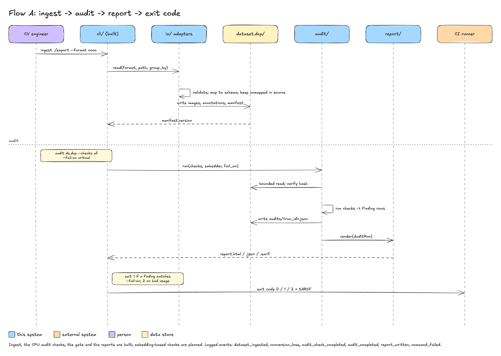
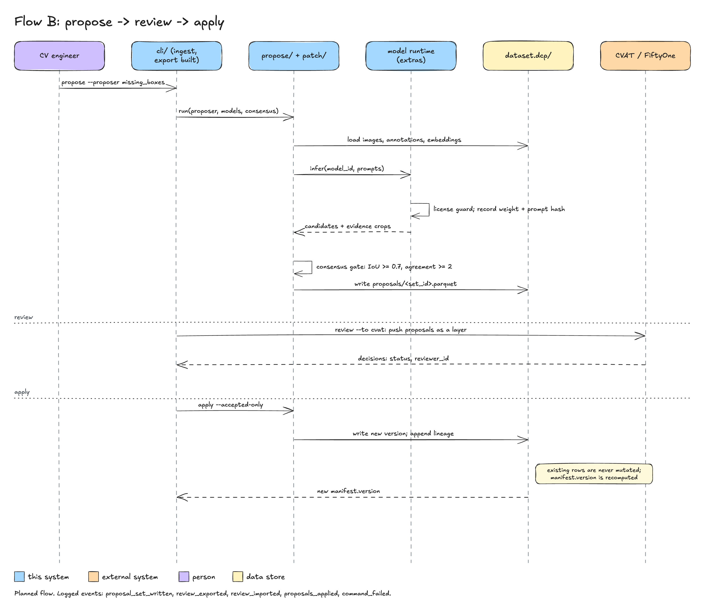

# 04 Flows

Flow A is built except the embedding-based checks (the audit steps below run the four CPU checks);
`export` is built; Flow B is planned. Exit
codes follow [errors-and-logging.md](../engineering/errors-and-logging.md): `0` success,
`1` the command ran and failed (including a gate or check that was asked to fail), `2`
usage or configuration error, `130` interrupted. Every failure is logged once, at the CLI
boundary, as `command_failed`.

## Flow A: ingest → audit → report → exit code

**Purpose:** turn a raw export into a `dataset.dcp/` version and decide, in CI or on a
laptop, whether the dataset is fit to train on.

**Preconditions:** the export directory exists and matches `--format`; images are readable
at their paths or URIs; for `--embedder`, the `[embed]` extra is installed and the model
license is allowed; the output directory is writable.

Steps:

1. `datacopilot ingest ./export --format coco -o ds.dcp [--group-by REGEX]` validates options
   (output must end in `.dcp`, the regex must compile) and loads settings (exit 2 on a bad
   option or `DATACOPILOT_*` value).
2. `convert.ingest` resolves the reader by name from `io/registry.py`; the reader streams
   `(Image, [Annotation])` pairs, keeps unmapped fields in `source`, and `image_id` is
   computed from file bytes.
3. Rows are validated against `core/schema.py` (invariants 1 to 6); the store writes
   `versions/<version>/`, then the top-level tables and `manifest.json`.
4. `manifest.version` is printed on `stdout`. (Steps 1 to 4 are built.)

`datacopilot export ds.dcp --format yolo -o ./out [--strict]` (built) reads the dataset
through the bounded, hash-verified store, resolves the writer by name, writes into a sibling
temporary directory, logs one `conversion_loss` per dropped column, fails with exit 1 and
writes nothing if `--strict` and anything was dropped, and otherwise renames the directory
into place and prints its path. The output directory must be absent or empty.
5. `datacopilot audit ds.dcp --checks all --report report.html` (the default gate is
   `--fail-on critical`; `--fail-on none` applies no gate) validates the
   options first (colliding report paths, `--allow-external-images` in CI without
   `--allow-external-images-in-ci`, unknown check, unknown or never-firing `--fail-on` token, a `--fail-on` check that
   is not part of the run: exit 2), reads the tables through the bounded, hash-verified store
   reader, and runs each check in `audit/registry.py` order. Checks that need embeddings (planned)
   would call the embedder (cache hit when `embeddings/<model>@<rev>.parquet` covers the images).
   The `duplicates` check uses the authenticated hash cache unless `--no-hash-cache`
   (or `DATACOPILOT_HASH_CACHE=false`) is given.
6. Findings are collected into an `AuditRun` (`run_id` is the invocation's `request_id`) and written
   to `audits/<run_id>.json`.
7. `report/` renders HTML, JSON and SARIF: `--report` (default `./report.html`), `--json` and
   `--sarif` (default: next to the HTML file, same name, `.json` / `.sarif`).
8. One result line goes to `stdout` (`passed|failed critical=N warn=N info=N run_id=ID`). The gate
   evaluates `--fail-on`: a match sets exit code 1; the reports are still written.

Failure paths:

| Condition | Behaviour | Exit code |
|---|---|---|
| Unknown command or option; invalid `DATACOPILOT_*` value | one line on `stderr`, no log record | 2 |
| `--format` not registered, or its extra is missing | `FormatError` names the format and the extra | 1 |
| Export directory missing or unreadable; malformed COCO/YOLO/VOC/ImageFolder content (invalid JSON, unsafe path, bad label line, XML with a DOCTYPE) | one `FormatError` naming the file and the problem | 1 |
| Two images with identical content; no images found | `ValidationError` / `FormatError` naming the files; nothing is written | 1 |
| `export` output not empty, or `--strict` with dropped fields | `FormatError` / `ConversionLossError` listing columns and counts; nothing is written | 1 |
| Table over `DATACOPILOT_MAX_TABLE_ROWS` / `_BYTES`, wrong Parquet schema, manifest counts that do not match | `StoreError` naming the file and the limit | 1 |
| A row violates an invariant (box out of bounds, unknown category) | `ValidationError` names `ann_id`/`image_id`; nothing is written | 1 |
| An image file is missing, unreadable, not a regular file, has an invalid header or a size that differs from its row during `integrity` | `Finding(check="integrity", severity=CRITICAL)`; the run continues | 0 unless `--fail-on` matches |
| `--checks` names an unknown check; `--fail-on` is unknown, empty, a check that is not built (for example `leakage`) or a check that is not in `--checks`; `--workers` out of range | one usage line on `stderr`; nothing is read or written | 2 |
| Images that were not examined: remote URIs, real path outside the dataset's parent directory (`--allow-external-images` opts in; refused in CI without `--allow-external-images-in-ci`), unhashable files | counted in a WARN finding, CRITICAL when more than 50 percent of the images are affected or with `--require-local-images`, so a dataset cannot pass by pointing its images elsewhere | 1 with the default gate once CRITICAL |
| Hash cache in CI (`CI` set) without `DATACOPILOT_CACHE_KEY`; directory, secret or file not private to this user; or a cached digest that fails the spot check | cache disabled (`audit_cache_untrusted`, reason `ci_without_key` and others), ignored or discarded, WARN event (and a `hash_cache_mismatch` WARN finding for a failed spot check); the audit continues | 0 unless `--fail-on` matches |
| Embedder requested without `[embed]` | error names `pip install "datacopilot[embed]"` | 1 |
| Model license not in `DATACOPILOT_ALLOWED_LICENSES` | `LicenseError` names model and license | 1 |
| `--fail-on` matches at least one finding (default gate: CRITICAL) | report written; `audit_completed` has `passed=false` | 1 |
| Dataset with no images | `ValidationError`: `dataset has no images`; nothing is written | 1 |
| Plugin code raises `SystemExit` or another `BaseException` (not `KeyboardInterrupt`) | the audit fails with `check '<name>' aborted the audit`; the exit status can never be 0 | 1 |
| `--report`, `--json` and `--sarif` resolve to the same file (case-insensitively on macOS and Windows) | usage error before anything runs | 2 |
| A check hits `max_check_seconds` or `max_hash_bytes` | `audit_incomplete` finding (CRITICAL when a gate is applied, else WARN) | 1 with the default gate |
| The dataset directory is read-only | reports are written first, then `audit_not_stored` (WARN) is logged; `--no-store-audit` skips storing | by the gate |
| Interrupted write of a version | temporary directory left behind and ignored by readers | 130 |

Logged events (all `INFO` unless stated): `dataset_ingested` (`format`, `image_count`,
`annotation_count`, `dataset_version`, `duration_ms`), `conversion_loss` (`WARN`;
`source_format`, `target_format`, `column`, `count`, `kind` = `dropped` or `skipped`), `dataset_exported`
(`format`, `image_count`, `annotation_count`, `dataset_version`, `dropped_count`, `skipped_count`,
`strict`, `duration_ms`), `audit_check_completed` (`check_name`, `findings_count`,
`duration_ms`), `audit_cache_unavailable`, `audit_cache_untrusted` and `audit_cache_discarded` (WARN, see
[06-cross-cutting.md](06-cross-cutting.md)), `embeddings_computed` (`model_id`, `model_revision`, `image_count`,
`cache_hits`), `audit_completed` (`run_id`, `dataset_version`, `critical`, `warn`, `info`,
`passed`), `report_written` (`format`, `path` = the file name only, never the directory), `command_failed` (`ERROR`; `command`,
`exc_info`). Expected failures also print one `error: ...` line on `stderr`.

Status: `ingest`, `export`, `audit` (CPU checks), the gate and the reports built; embedding-based
checks planned.

## Flow B: propose → review export → apply

**Purpose:** let models suggest fixes, route them to a reviewer, and apply only accepted
ones as a new dataset version with full provenance.

**Preconditions:** a `dataset.dcp/` exists; the `[vlm]` and/or `[sam3]` extra is installed
on the machine that runs `propose`; the models' licenses are allowed; the user has
downloaded gated weights with their own token; a CVAT project or FiftyOne dataset name is
available for review.

Steps:

1. `datacopilot propose ds.dcp --proposer missing_boxes --models grounding-dino-base,sam3 --consensus 2`.
2. `propose/` loads images, annotations and cached embeddings; an embedding prefilter
   selects suspicious images so proposers run only where needed.
3. For each model the runtime checks the license allow-list, records `weight_hash` and
   `prompt_hash`, runs inference, and returns candidates with evidence crops.
4. `consensus` keeps candidates on which at least `--consensus` models agree (box IoU ≥
   0.7 for boxes; a "yes" above threshold for class verification). Nothing is accepted
   automatically; consensus only ranks.
5. The set is written to `proposals/<set_id>.parquet` with `status=pending`.
6. `datacopilot review ds.dcp --proposals latest --to cvat --project 12` pushes the
   proposals as a separate layer (pre-annotated task in CVAT, a `Detections` field in
   FiftyOne); decisions come back through `review --from` or `ProposalSet.import_decisions`
   with `status` and `reviewer_id`.
7. `datacopilot apply ds.dcp --proposals latest --accepted-only` writes a new version:
   accepted `add_box` rows become annotations with `provenance=proposal_accepted`;
   `change_class`, `refine_box`, `delete_box` produce changed rows in the new snapshot;
   the previous snapshot is untouched and `lineage` is appended.
8. The new `manifest.version` is printed on `stdout`.

Failure paths:

| Condition | Behaviour | Exit code |
|---|---|---|
| Proposer or model not registered; extra missing | error names the extra | 1 |
| Model license not allowed, or gated weights not downloaded | `LicenseError` / `ModelError` with the Hub repo and the variable to set | 1 |
| GPU out of memory | `ModelError` with `gpu_memory_gb` hint from the registry; nothing written | 1 |
| vLLM endpoint unreachable or non-2xx | `ModelError` with status code; no retries beyond 3 with backoff | 1 |
| Model output fails validation (box outside image, unknown class) | candidate dropped, counted in `proposal_candidates_rejected` (`WARN`) | 0 |
| CVAT or FiftyOne unavailable during `review` | `IntegrationError`; proposals stay `pending` | 1 |
| `apply` with proposals whose `target_ann_id` no longer exists in the current version | `ValidationError` lists the ids; nothing written | 1 |
| `apply` interrupted | temporary snapshot ignored; current version unchanged | 130 |

Logged events: `proposer_started` (`proposer`, `model_id`, `model_revision`,
`image_count`), `proposal_set_written` (`set_id`, `proposal_count`, `high_confidence_count`),
`proposal_candidates_rejected` (`WARN`; `reason`, `count`), `review_exported` (`target`,
`set_id`, `proposal_count`), `review_imported` (`accepted`, `rejected`, `pending`),
`proposals_applied` (`parent_version`, `dataset_version`, `applied_count`),
`command_failed` (`ERROR`). Tokens for CVAT, Hugging Face or vLLM are never logged; keys
ending in `_token` or `_api_key` are redacted by the logging contract.

Status: planned.
