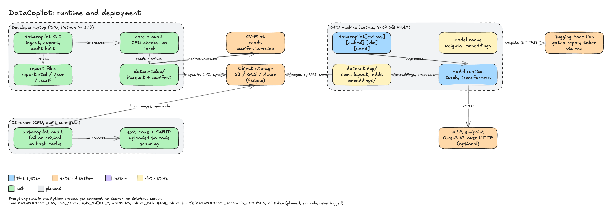

# 05 Runtime

## Process model

- One Python process per command. No daemon, no server, no background workers between
  commands. `datacopilot --version` and `doctor` (built) run and exit in one thread.
- Built: the `integrity` (header reads) and `duplicates` (streamed sha256) checks run on a
  `ThreadPoolExecutor` with `--workers` threads (default `DATACOPILOT_WORKERS`, else
  `os.cpu_count()`, at most 256). Threads, not processes: both are I/O bound and `hashlib`
  releases the GIL on large chunks, so there is no pickling or spawn cost; the `boxes` and
  `imbalance` checks are single-threaded NumPy and counting passes. No decoding of pixels happens
  anywhere in the CPU audit.
- Planned: image decoding for embedding steps runs in a `concurrent.futures.ProcessPoolExecutor`,
  each worker taking a slice of `image_id`s; results returned as Arrow batches.
- Not planned any more for Phase 2: DuckDB table scans. The audit reads the tables through the
  bounded store reader and works on NumPy arrays ([ADR-0003](../adr/0003-repo-and-tooling.md)).
- Planned: model inference runs in-process on the local GPU or CPU (`[embed]`, `[vlm]`,
  `[sam3]`); Qwen3-VL may instead be called over HTTP on a vLLM endpoint, in which case no
  model is loaded locally.
- No subprocesses are spawned for external tools; CVAT and FiftyOne are reached through
  their Python SDKs in-process.
- `request_id` (a UUID) is bound at startup and cleared at exit; the planned `AuditRun.run_id`
  reuses it.

## Deployment nodes

| Node | What runs there | Needs |
|---|---|---|
| Developer laptop (CPU) | the CLI, core library, format adapters, CPU checks, report generator, a local `dataset.dcp/` | Python ≥ 3.10, core wheel |
| GPU machine | the same plus `[embed]`, `[vlm]`, `[sam3]`; embedders, proposers; model cache | 8 GB VRAM for ViT-B embeddings and Grounding DINO base; 16–24 GB for SAM 3; Qwen3-VL-8B ~16 GB F16 or ~5 GB Q4; `[sam3]` needs Python ≥ 3.12, PyTorch ≥ 2.7, CUDA ≥ 12.6 |
| CI runner | `datacopilot audit --fail-on …` as a gate, `report.sarif` uploaded to code scanning; no extras unless embeddings are precomputed | core wheel, read access to `dataset.dcp/` and images |
| Object storage (S3, GCS, Azure) | image files referenced by URI; optionally the `dataset.dcp/` directory itself | `fsspec` with the matching filesystem package |
| vLLM endpoint (optional) | Qwen3-VL served by vLLM; receives image crops, returns text | network reachability; an API key if the server requires one |
| Hugging Face Hub | source of weights; gated repos require the user's token | outbound HTTPS |
| CV-Pilot (sibling) | reads `manifest.json` from the dataset directory to record `manifest.version` | file or object-storage read access |

## Storage locations

| Data | Location | Default |
|---|---|---|
| Dataset | `dataset.dcp/` given on the command line | required argument; may be an `fsspec` URI |
| Images | wherever `file_path` points | never copied |
| Embedding cache | inside the dataset: `embeddings/<model_id>@<revision>.parquet` | always on |
| Model weights | Hugging Face cache (`HF_HOME`, default `~/.cache/huggingface`) | upstream default |
| DataCopilot cache (thumbnails, evidence crops, FAISS indexes) | `DATACOPILOT_CACHE_DIR` | `$XDG_CACHE_HOME/datacopilot`, else `~/.cache/datacopilot` |
| Reports | `--report <path>`; `.json` and `.sarif` next to it unless `--json` / `--sarif` are given | `./report.html` |
| Audit runs | `audits/<run_id>.json` inside the dataset | always |
| Hash cache | `DATACOPILOT_CACHE_DIR`: `sha256-v2.cache` and `secret.key`, directory mode 0700, files 0600 | on unless `--no-hash-cache` |
| Logs | `stderr`, JSON lines | always; nothing written to disk by the logger |

## Configuration

Environment variables with the `DATACOPILOT_` prefix. Precedence, highest first:
command-line option, environment variable, built-in default. There is no configuration
file.

| Variable | Values | Default | Status |
|---|---|---|---|
| `DATACOPILOT_ENV` | `dev`, `staging`, `prod` | `prod` | built |
| `DATACOPILOT_LOG_LEVEL` | `DEBUG`, `INFO`, `WARNING`, `ERROR`; `DEBUG` honoured only when `ENV=dev` | `INFO` | built |
| `DATACOPILOT_MAX_TABLE_ROWS` | integer ≥ 1; row limit per Parquet table on read | `5000000` | built |
| `DATACOPILOT_MAX_TABLE_BYTES` | integer ≥ 1; uncompressed-size limit per Parquet table on read | `4294967296` | built |
| `DATACOPILOT_ALLOWED_LICENSES` | comma-separated SPDX ids and custom names, e.g. `Apache-2.0,MIT,SAM-License` | `Apache-2.0,MIT,BSD-3-Clause` | built (case-insensitive; empty or malformed is exit 2; reaches `audit` and `embed` through the real CLI path, tested) |
| `DATACOPILOT_CACHE_DIR` | directory path (not empty, not `.`) | see storage table | built (hash cache) |
| `DATACOPILOT_WORKERS` | integer 1 to 256 | `os.cpu_count()` | built (`audit`) |
| `DATACOPILOT_CACHE_KEY` | secret, 16 to 1024 characters; out-of-band MAC key of the hash cache, never stored next to it; required to use the cache when `CI` is set | unset | built |
| `CI` | any value except empty, `0`, `false`, `no`: marks a CI environment (cache needs the key; `--allow-external-images` needs `--allow-external-images-in-ci`) | unset | built (read, not prefixed) |
| `DATACOPILOT_HASH_CACHE` | `true` or `false` | `true`; CI gates should set `false` | built (`audit`; `--hash-cache/--no-hash-cache` override it) |
| `DATACOPILOT_VLLM_URL` | `http(s)://host:port/v1` | unset (local inference) | planned |

An invalid value exits with code 2 and one line on `stderr` before logging is configured
(built behaviour for the two existing variables).

## Secrets

| Secret | Where it may live | Where it must never appear |
|---|---|---|
| Hugging Face token (gated weights) | `HF_TOKEN` or `DATACOPILOT_HF_TOKEN` in the environment; the Hub's own credential store | command-line arguments, `manifest.json`, reports, logs, proposals, `source` dicts |
| CVAT credentials | `DATACOPILOT_CVAT_TOKEN` (or the SDK's own auth) | same |
| vLLM API key | `DATACOPILOT_VLLM_API_KEY` | same |
| Object storage credentials | the cloud SDK's standard environment or instance role | same |

The logging contract redacts any key named `token`, `password`, `api_key`, `jwt` or
`authorization`, or ending in `_token`, `_api_key`, and so on (built). The variable names
above are chosen so the suffix rule covers them. Redaction is key-based: a secret must
never be placed in a free-text field or an exception message.

## Optional extras

| Extra | Unlocks | Dependencies (planned) | Hardware |
|---|---|---|---|
| `embed` | embedders `dinov2-*`, `dinov3-*` (gated; DINOv3 License), `siglip2-*`; near-duplicate, leakage, outlier and label-noise checks | `torch`, `transformers`, `faiss-cpu` | CPU works (slow); GPU with 8 GB VRAM recommended |
| `vlm` | proposers `missing_boxes` (Grounding DINO), `class_verify` (Qwen3-VL locally or via `DATACOPILOT_VLLM_URL`) | `torch`, `transformers`, an OpenAI-compatible HTTP client | 8–12 GB VRAM local; none when using a vLLM endpoint |
| `sam3` | `box_refine` and SAM 3 agreement in `missing_boxes` | the SAM 3 package; user accepts the SAM License on the Hub | 16–24 GB VRAM; Python ≥ 3.12, PyTorch ≥ 2.7, CUDA ≥ 12.6 |
| `fiftyone` | `review --to fiftyone`, `ProposalSet.to_fiftyone`, `from_fiftyone` | `fiftyone` (Apache-2.0; runs its own MongoDB) | CPU |
| `cvat` | `review --to cvat`, decisions import | `cvat-sdk` (MIT) | network to a CVAT server |
| `cleanlab` | Cleanlab confident learning as the backend of the `label_noise` check (classification and detection); without it the check is skipped with a `WARN` | `cleanlab` (AGPL-3.0; imported lazily inside the adapter). Notice: installing and using this extra makes the user's combined work subject to AGPL-3.0 ([ADR-0001](../adr/0001-scope-and-license.md)) | CPU |

All extras are imported inside the function that needs them; a missing extra produces one
error line naming the `pip install "datacopilot[<extra>]"` command and exit code 1.
