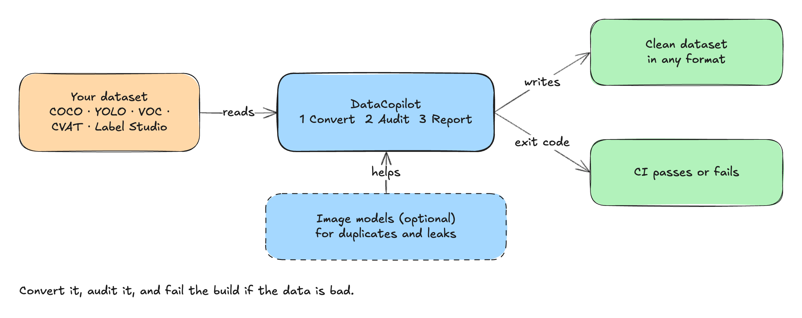

# DataCopilot architecture

## The 30-second picture

- You give it a dataset in COCO, YOLO, Pascal VOC, CVAT or Label Studio format.
- It reads the dataset into one internal format, a `dataset.dcp/` folder.
- It can write that dataset back out in any format and counts whatever a format cannot hold.
- It audits the dataset and writes a report; the exit code says pass or fail, so CI can stop a bad dataset.
- Image models are optional and only add near-duplicate and leak checks. The sections below are the technical detail.

This directory is the single source of truth for how DataCopilot is built. It follows the
[C4 model](https://c4model.com) from the outside in, then covers data, runtime behaviour,
deployment and cross-cutting concerns. Decisions that shaped it are recorded as ADRs.

| Document | Question it answers | Diagram |
|---|---|---|
| [01-overview.md](01-overview.md) | What is the system, who uses it, what must it guarantee, what is out of scope | `context`, `containers` |
| [02-components.md](02-components.md) | What are the packages, what does each own, what may depend on what | `components` |
| [03-data-model.md](03-data-model.md) | What are the entities, their keys, relations, invariants and on-disk layout | `data-model` |
| [04-flows.md](04-flows.md) | How the key operations run end to end, including failure paths and exit codes | `flow-a`, `flow-b` |
| [05-runtime.md](05-runtime.md) | Where code runs, what it reads and writes, where config and secrets live | `runtime` |
| [06-cross-cutting.md](06-cross-cutting.md) | Logging, configuration, errors, security, licensing, observability | — |
| [../adr/](../adr/README.md) | Why it is this way | — |

## How to read the diagrams

- Diagrams are generated from `docs/diagrams/*.diagram.mjs`. The PNG embeds the scene, so any
  PNG can be dropped into [excalidraw.com](https://excalidraw.com) and edited.
- Colours: blue = this system or one of its containers, orange = external system, purple =
  person, yellow = data store, green = built and tested today, grey = planned.
- Arrows point in the direction of the dependency or call. In the component view they only
  point downward between layers (see [ADR-0004](../adr/0004-layering-and-dependency-rule.md)).

## Status markers

Every component and flow is marked **built** or **planned**. "Built" means it exists in
`src/`, has tests, and its commands appear in the README from a real run. Anything else is
planned, however detailed its description. Marking is updated in the same change that ships
the code.

## Keeping this current

A change that adds a package, a public interface, a stored entity or an external dependency
updates the matching document and diagram in the same pull request. The review checklist in
[../engineering/workflow.md](../engineering/workflow.md) enforces this.
